# HR-Driven Identity Lifecycle with midPoint

In this lab I set up Evolveum midPoint so that HR is the source of truth for who works here. My HR system, SimplifyHR, holds the employee records. midPoint reads them, creates a user for each person, and keeps those users in line with HR from then on. From there, midPoint pushes each person out to OpenLDAP (`dc=idpnode,dc=net`) as a directory account.

> **Where it's at:** Both phases are done and working. Phase 1 gets people from HR into midPoint and keeps them in sync. Phase 2 provisions them out to LDAP through a role. The full pipeline is written up in [joiner-leaver](joiner-leaver/). See the [roadmap](#roadmap) for what's next.

---

## How it fits together

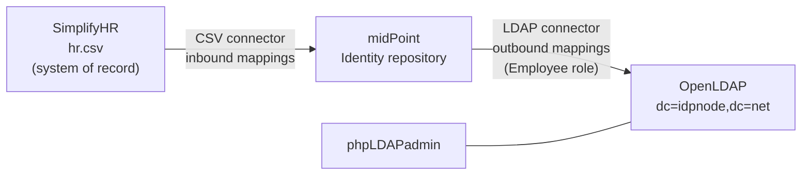

- **SimplifyHR** is the source. midPoint reads its export from `/opt/midpoint/var/import/hr.csv`, and every record is keyed on `empid`.
- **midPoint** does the identity work. It connects to HR with the ConnId CSV connector (`com.evolveum.polygon.connector.csv.CsvConnector`, v2.9).
- **OpenLDAP** is the target directory, base DN `dc=idpnode,dc=net`. I manage it through phpLDAPadmin 1.2.5.

---

## What I built

### 1. Connecting HR to midPoint

I set up the HR system as a resource in midPoint using the CSV connector, with `empid` as both the naming attribute and the unique attribute. The connection test passes every check: the connector loads, initializes, connects, reports its capabilities and returns the schema.

One thing I made a point of doing was turning off the delete capability on this resource. HR is the system of record, so midPoint should never be able to delete anything from it, even if a sync rule goes wrong.

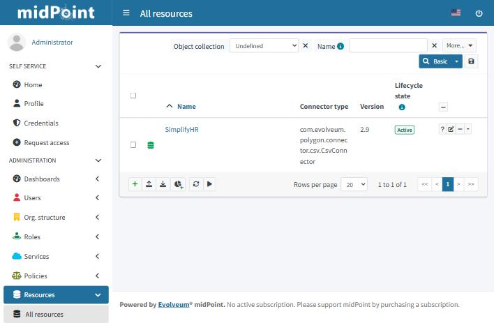
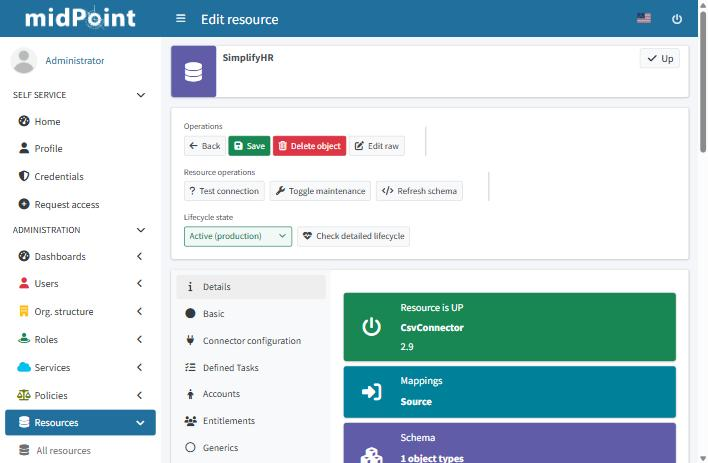
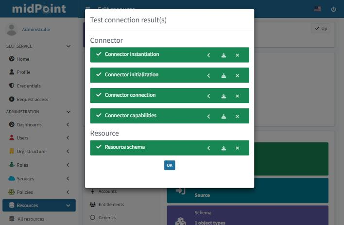

### 2. Mapping HR fields onto midPoint users

Each HR field has an inbound mapping that sets a property on the midPoint user:

| HR field | midPoint property | How |
|---|---|---|
| `empid` | `name` | Copied straight across |
| `firstname` | `givenName` | Copied straight across |
| `lastname` | `familyName` | Copied straight across |
| `firstname` + `lastname` | `emailAddress` | Groovy script builds `first.last@idpnode.net` with accents stripped |
| `department` | `organizationalUnit` | Copied straight across |
| `costcenter` | `costCenter` | Copied straight across |
| `status` | `activation/administrativeStatus` | Groovy script: `Active` becomes ENABLED, anything else DISABLED |

Every mapping is set to strong, which means HR always wins. If someone edits one of these fields by hand in midPoint, the next sync puts the HR value back.

The email mapping had to deal with international names. It normalizes the name to Unicode NFD, strips the accent marks, turns `ß` into `ss`, and drops anything that still isn't a letter or number. That's how Sophie Müller ends up as `sophie.muller` and not a broken address. The script is in [`email-generation.groovy`](config/scripts/email-generation.groovy).

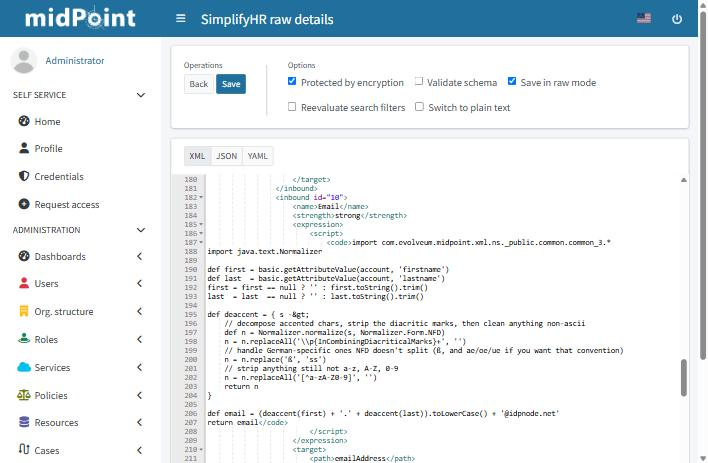

The status mapping is my leaver control. As soon as HR marks someone as anything other than `Active`, midPoint disables them on the next sync. That one is in [`status-to-activation.groovy`](config/scripts/status-to-activation.groovy).

### 3. Correlation and sync rules

For correlation, midPoint matches an HR record to an existing user on `name`, which is the `empid`.

Then I told midPoint what to do in each situation it can find:

| Situation | What it means | What midPoint does |
|---|---|---|
| `unmatched` | A new hire in HR with no midPoint user yet | `addFocus`: creates the user |
| `unlinked` | The user exists but isn't tied to the HR record | `link` |
| `linked` | Already tied together | `synchronize`: applies any HR changes |

### 4. Reconciliation

I created a reconciliation task, `SimplifyHR Reconciliation`, and ran it. It went through all 7 HR records in about a second and finished with **Success**. Every HR account ended up **LINKED** to its own midPoint user.

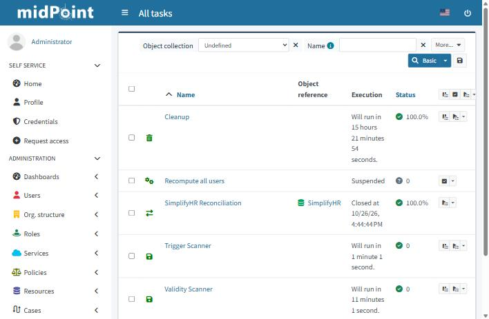
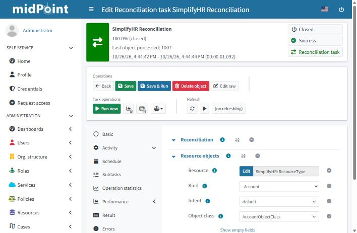
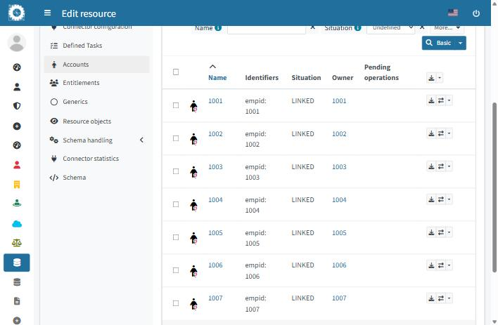

---

## What came out of it

midPoint now has 7 employee identities created from HR, plus the built-in administrator. Each one has exactly one linked account on the SimplifyHR resource and an `@idpnode.net` email from the current mapping.

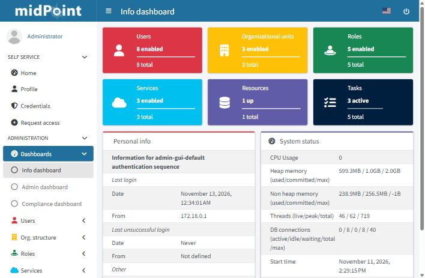
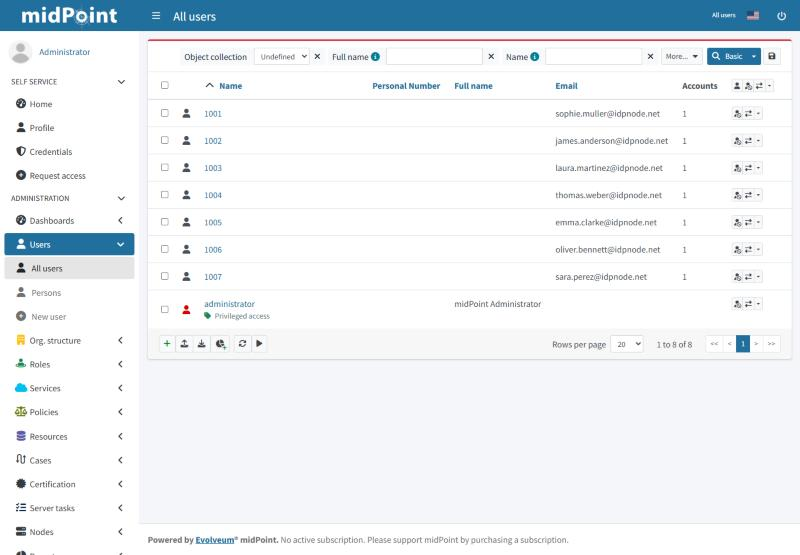

Here's user `1001` with every HR-sourced attribute filled in, and the HR account linked to it:

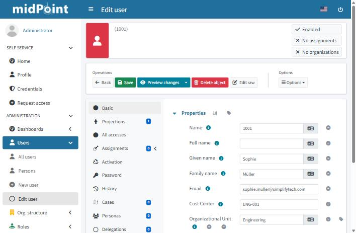
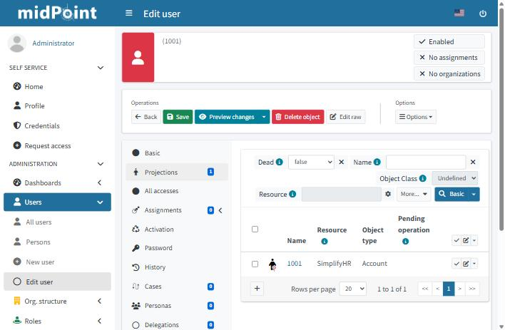

And the LDAP directory as it looked before Phase 2, with the base set up and empty. The provisioned entries are in [joiner-leaver](joiner-leaver/):

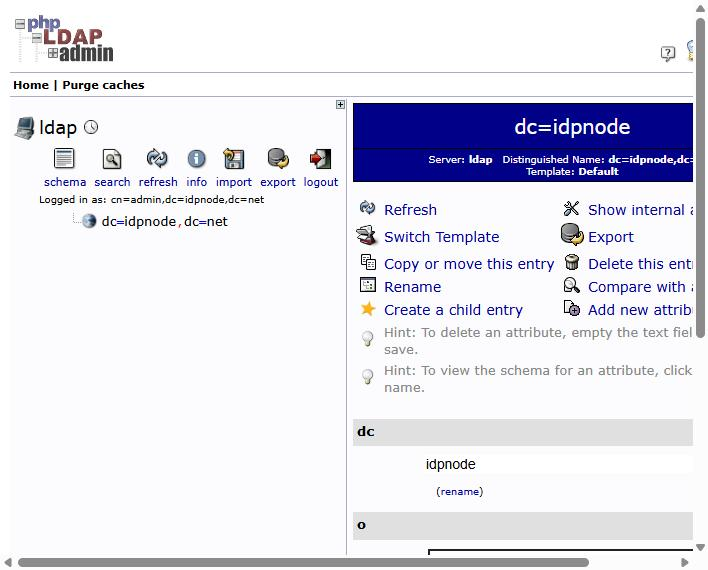

---

## What I learned

- **Changing a mapping doesn't fix existing users.** I changed the email domain in the mapping after the first reconciliation, and the users who already existed kept their old address until they were recomputed. Once I ran a recompute, all 7 picked up the new `@idpnode.net` address. Now I know any mapping change needs a recompute or reconciliation run planned alongside it.
- **Clean up names before building identifiers from them.** Without Unicode normalization, an accented name like Müller would have produced a broken email address or login.
- **Protect the source of record.** With delete turned off on the HR resource, a bad sync rule can't wipe out the data everything else depends on.
- **Strong vs. normal mappings matter.** Strong mappings are what make HR the boss. Any drift gets overwritten on every sync.

---

## Roadmap

- [x] **Phase 2: LDAP provisioning.** Add an LDAP resource for `dc=idpnode,dc=net` with outbound mappings (`uid`, `cn`, `sn`, `givenName`, `mail`), putting users under `ou=people`. Done: the DN script builds `uid=<empid>,ou=people,dc=idpnode,dc=net`, I also map `departmentNumber` and `employeeNumber`, and an auto-assigned `Employee` role creates the account.
- [x] Recompute all users so they pick up the current email mapping.
- [ ] Add a `fullName` mapping (`givenName + ' ' + familyName`).
- [ ] Create org units per department and birthright roles assigned from `department`.
- [ ] Map `manager` to an org-manager relationship.
- [ ] Test mover and leaver cases: change someone's department and terminate someone in HR, then check what happens in midPoint and LDAP.

---

## What's in this folder

```
├── README.md
├── docs/walkthrough.md               How I built it, step by step
├── config/
│   ├── simplifyhr-resource.xml       The HR resource definition (inbound)
│   ├── outbound-mappings.xml         LDAP outbound mappings and correlation
│   ├── employee-role.xml             Role that creates the LDAP account
│   ├── service-accounts-nhi.xml      Service account type: owner linking and orphan handling
│   └── scripts/
│       ├── email-generation.groovy
│       ├── status-to-activation.groovy
│       └── ldap-dn.groovy
├── joiner-leaver/                    The joiner / leaver use case write-up
├── nhi-ownership/                    Service accounts linked to owners, orphans flagged
├── sample-data/hr.csv                The HR file format (one sample row)
└── screenshots/
```

## Skills this covers

Identity lifecycle management (joiner/leaver) · designing around an authoritative source · midPoint resource configuration · ConnId CSV connector · inbound mappings and Groovy expressions · correlation and sync policy · reconciliation · outbound mappings and DN construction · role-based provisioning · non-human identity ownership and orphan detection · LDAP directory design
