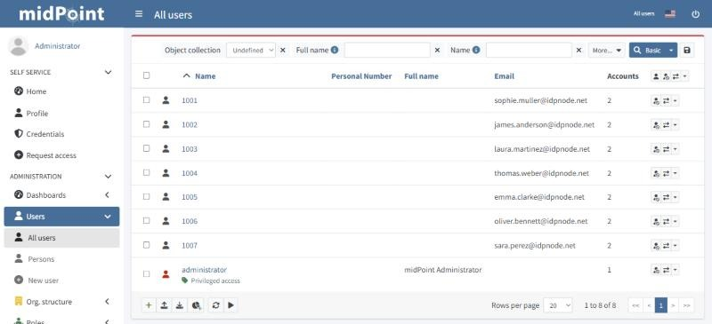
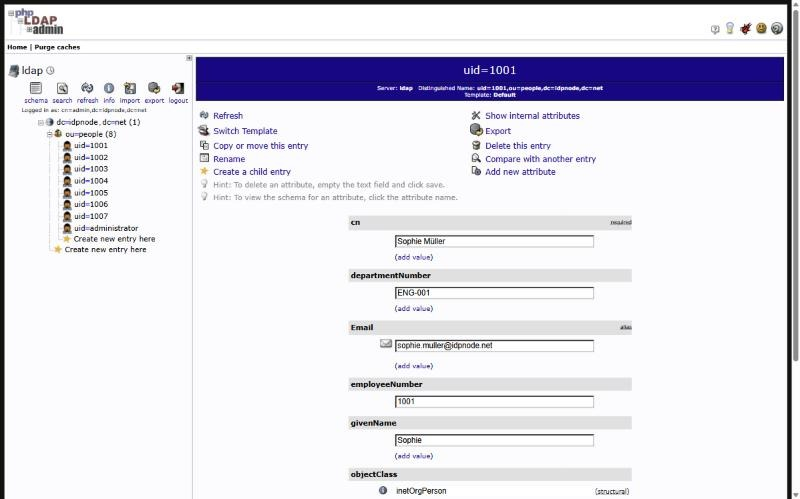

# Joiner / Leaver: HR-driven provisioning, source to IGA to directory

This is the full pipeline working end to end. Someone gets hired in HR, midPoint creates their identity, and they get a directory account in OpenLDAP without anyone touching LDAP by hand. HR stays the only place employment status is decided, and everything downstream follows from it.

```
SimplifyHR (hr.csv)  ──inbound──▶  midPoint user  ──Employee role──▶  OpenLDAP account
   system of record                  identity                          uid=<empid>,ou=people,dc=idpnode,dc=net
```

## How it works

The first half is inbound. midPoint reads each HR record, correlates it on employee ID so nobody gets duplicated, and builds the user from it. That includes generating the email and setting enabled or disabled from the HR status.

The second half is outbound. Outbound mappings do the reverse of inbound ones: they take properties of the midPoint user and write them onto the LDAP account. Given name, surname, a `cn` built from both, email, cost center as `departmentNumber`, and the employee ID as `employeeNumber`. They're all strong, so if someone edits an entry directly in LDAP, midPoint puts it back on the next sync.

Every LDAP entry needs a distinguished name (DN), which is its full path in the directory tree. I build it with a small Groovy script: `uid=` plus the employee ID, placed under `ou=people`. The script is written so that a disabled user's DN points to `ou=inactive` instead, which keeps leavers out of the active people branch.

The account itself comes from a role, not from a rule on the resource. I created an `Employee` business role whose inducement says "members get an OpenLDAP account". midPoint assigns that role automatically to every user who isn't disabled. So a new hire gets the account without anyone clicking anything, and the access is tied to a reason (being an employee) that you can review later. That's the difference between role-based provisioning and just pushing every user everywhere.

## Screenshots



All seven employees now have 2 accounts each: the HR record they came from, and the LDAP account midPoint created for them.


User 1001's linked accounts: the SimplifyHR record and the OpenLDAP entry at `uid=1001,ou=people,dc=idpnode,dc=net`, with the DN built by the script.


The `Employee` business role. Its one inducement is an OpenLDAP account, so membership in the role is what gives someone a directory account.


The directory tree in phpLDAPadmin: `ou=people` now holds `uid=1001` to `uid=1007`, one for each employee, all created by midPoint. The eighth entry, `uid=administrator`, is midPoint's built-in admin. It got an LDAP account because the `Employee` role is auto-assigned to every enabled user, admin included. Narrowing that rule to HR-sourced users would keep accounts like this out of the people branch.



Sophie Müller's entry (`uid=1001`) up close, showing the values that came all the way from HR: `cn`, `departmentNumber`, email, `employeeNumber` and `givenName`.


Both ends of the pipeline as midPoint resources: SimplifyHR as the source (CSV connector) and OpenLDAP as the target (LDAP connector 3.9.4).


The first stage on its own: the seven identities midPoint created from HR records, before LDAP was connected.


The audit log filtered to the day of the HR reconciliation run, so every change midPoint made can be traced back to the sync that caused it.

## The config behind it

**HR to midPoint (inbound)**
- [`simplifyhr-resource.xml`](../config/simplifyhr-resource.xml): the HR resource, with inbound mappings, correlation on `empid`, and delete turned off so midPoint can never remove anything from HR.
- [`email-generation.groovy`](../config/scripts/email-generation.groovy): builds `first.last@idpnode.net` and strips accents, so Müller becomes `muller`.
- [`status-to-activation.groovy`](../config/scripts/status-to-activation.groovy): the leaver control. Any HR status other than `Active` disables the user.

**midPoint to LDAP (outbound)**
- [`outbound-mappings.xml`](../config/outbound-mappings.xml): the outbound mappings from the LDAP resource, showing what each LDAP attribute is built from, plus correlation. I trimmed it down to the part I designed and left out the connector settings and the bind password.
- [`ldap-dn.groovy`](../config/scripts/ldap-dn.groovy): the DN script, `uid=<empid>` under `ou=people`, or `ou=inactive` for disabled users.
- [`employee-role.xml`](../config/employee-role.xml): the `Employee` role, with the LDAP account inducement and the auto-assignment for every user who isn't disabled.

The full build for the HR side is in the [walkthrough](../docs/walkthrough.md).
