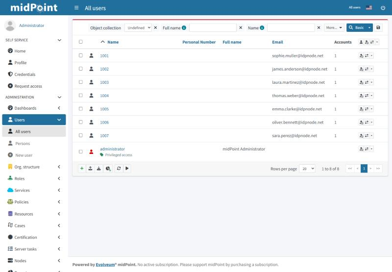

# Joiner / Leaver: HR-driven identity onboarding, source to IGA

The idea here is simple: HR is the only place a person's employment status should be decided. If someone is hired, midPoint should create their identity on its own. If HR marks them as gone, midPoint should disable them. Nobody should be creating or removing accounts by hand.

## How it works

Provisioning means accounts get created and kept up to date automatically from one trusted source, which here is HR. I set that up with inbound mappings. Each one takes a field from the HR record and turns it into an attribute on the midPoint user. Most are one-to-one, like `empid` to username or `department` to org unit. Two of them do a bit more work: one builds the email address from the person's name, and the other turns the HR status into enabled or disabled.

Correlation is the check midPoint does before it creates anyone. It asks whether this HR record already belongs to an existing user, matching on employee ID. Without that, every sync could create duplicates, and duplicate identities are how people end up with access nobody can explain later.

## Screenshots

All seven employees (1001 to 1007) created from HR records. Each one got a generated `first.last@idpnode.net` email and is linked to exactly one HR account.

The audit log filtered to today, showing the reconciliation run going through each HR user. Every change midPoint makes can be traced back to the sync that caused it.

## The config behind it

- [`simplifyhr-resource.xml`](../config/simplifyhr-resource.xml) is the full resource definition: the CSV connector settings, all the inbound mappings, correlation on `empid`, the sync reactions, and the delete capability turned off so midPoint can never remove anything from HR.
- [`email-generation.groovy`](../config/scripts/email-generation.groovy) builds the email address. It strips accents first, so Sophie Müller becomes `sophie.muller` and not something broken.
- [`status-to-activation.groovy`](../config/scripts/status-to-activation.groovy) is the leaver part. Any HR status other than `Active` disables the user.

The sync reactions are what make it a joiner flow. A new HR record with no matching user gets a new user (`unmatched → addFocus`). A user who exists but isn't linked yet gets linked (`unlinked → link`). Anyone already linked just gets their HR changes applied (`linked → synchronize`).

I wrote up the full build step by step in the [walkthrough](../docs/walkthrough.md).
