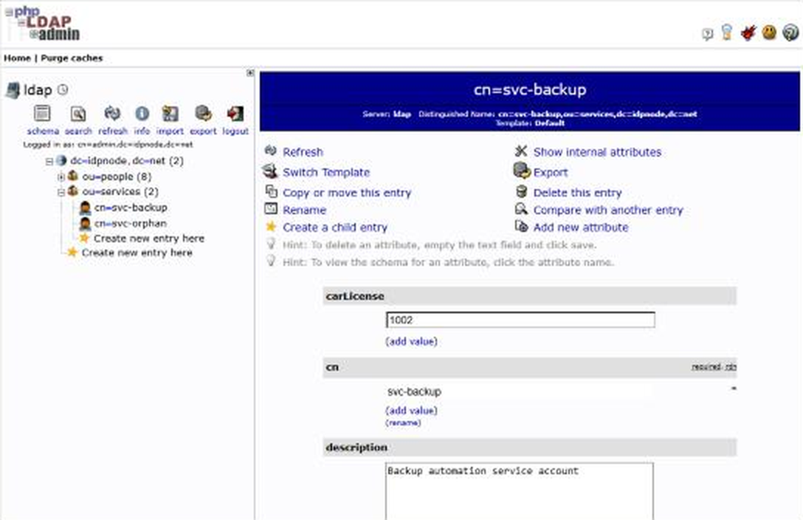
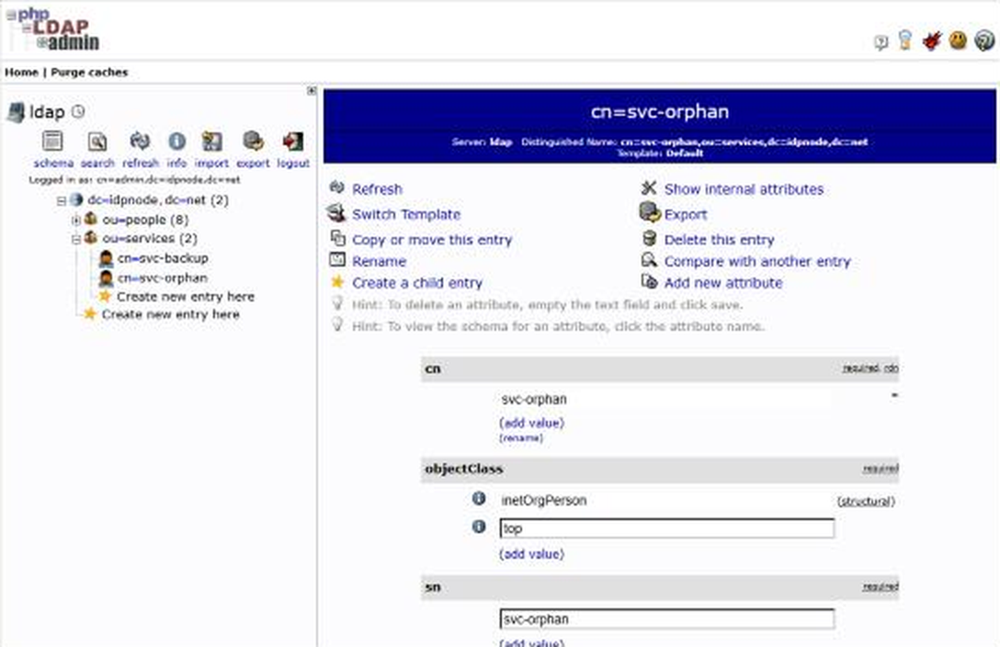
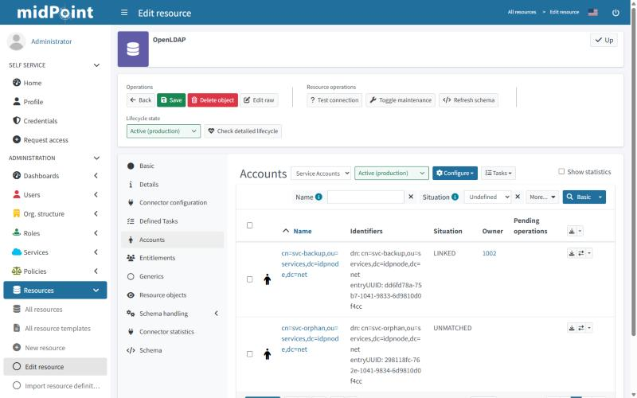
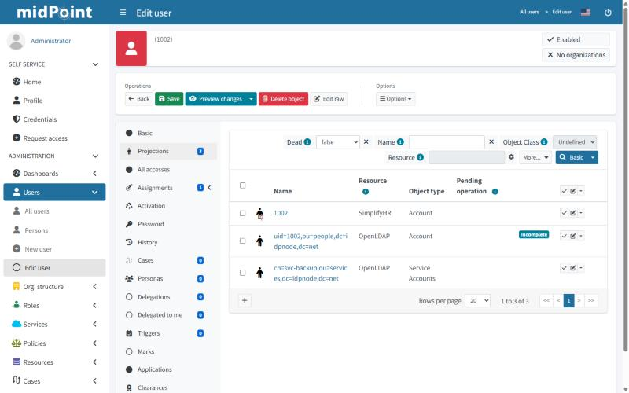
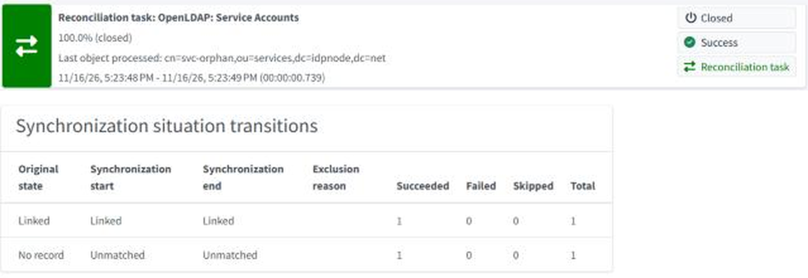
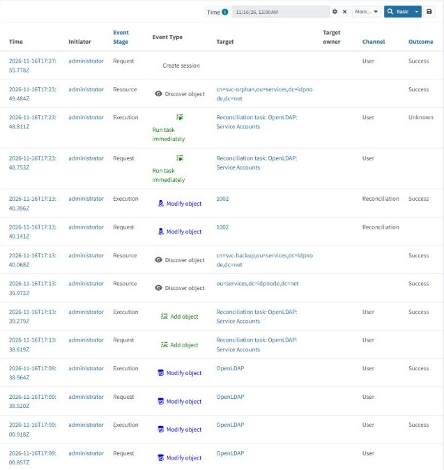

# Non-human identities: linking service accounts to owners, and catching orphans

Service accounts don't have an HR record. Nobody gets hired or leaves, so the joiner/leaver pipeline never sees them, and that's how they end up as orphans: accounts with access that nobody owns and nobody reviews. In this use case I made midPoint treat service accounts as their own type, link each one to the person who owns it, and flag any service account that has no owner instead of quietly ignoring it or turning it into a fake user.

```
OpenLDAP ou=services                         midPoint
  cn=svc-backup  (carLicense: 1002)  ──correlate on owner──▶  user 1002 (James Anderson)   LINKED
  cn=svc-orphan  (no owner)          ──no match──────────────▶  flagged, no user created     UNMATCHED
```

## How it works

I added a second object type to the OpenLDAP resource, **Service Accounts** (intent `NHI`), next to the existing employee account type. Its delineation only covers `ou=services`, and I narrowed the employee type to `ou=people`. Now each account in the directory falls into exactly one bucket.

Each service account records its owner's employee ID. `inetOrgPerson` has no built-in owner field, so I use `carLicense` for it. An inbound mapping takes that value, and correlation on `name` matches it to the owner's midPoint user. When reconciliation finds `svc-backup` with `carLicense: 1002`, it links the account to user `1002` as one of his projections. From then on, the service account shows up on James's record next to his HR and LDAP accounts, so anyone reviewing his access sees it.

Orphans are handled by what I *didn't* configure. The `unmatched` reaction for this type has no action. If a service account has no owner, or an owner that doesn't exist, midPoint doesn't create a user for it and doesn't delete it. It stays **UNMATCHED** in the resource's account list, where it's visible and has to be dealt with by a person. That was a deliberate choice: auto-creating a "user" for a service account would hide the problem, and auto-deleting it could break whatever depends on it.

## Screenshots



`ou=services` in the directory holds two service accounts. `svc-backup` is a backup automation account, and its `carLicense` holds `1002`, the employee ID of its owner.



`svc-orphan` has only `cn`, `sn` and its object classes. There's no owner recorded anywhere, which is exactly what an orphaned account looks like in a real directory.



The OpenLDAP resource's Service Accounts view in midPoint, showing the result: `svc-backup` is **LINKED** with owner `1002`, and `svc-orphan` is **UNMATCHED** with no owner.



User `1002` now has three linked accounts: his HR record, his own LDAP account in `ou=people`, and `cn=svc-backup` with the object type **Service Accounts**. Ownership is visible right on the person.



The `OpenLDAP: Service Accounts` reconciliation finished with Success in under a second and processed 2 objects. Its situation table shows one account staying **Linked** (svc-backup) and one going from **No record → Unmatched** (svc-orphan).

## The audit trail



Times are UTC on 16 November, oldest first:

| Time | Event | What it means |
|---|---|---|
| 16:57–17:09 | Execute changes raw / Modify object `OpenLDAP` | Configuring the resource: adding the Service Accounts type and narrowing the employee type to `ou=people` |
| 17:13:38 | Add object: Reconciliation task `OpenLDAP: Service Accounts` | Creating and running the reconciliation for the new type |
| 17:13:39 | Resource: Discover object `ou=services,…` and `cn=svc-backup,…` | midPoint finds the services branch and the first service account |
| 17:13:40 | Modify object `1002` (Reconciliation) | svc-backup is linked to its owner, user `1002` |
| 17:23:48 | Run task immediately: `OpenLDAP: Service Accounts` | Running the reconciliation again |
| 17:23:49 | Resource: Discover object `cn=svc-orphan,…` | svc-orphan is found. No user is modified afterwards, because there's no owner to link to |

The difference between the two service accounts shows up in the log itself. `svc-backup` is followed by a change to its owner's record, and `svc-orphan` is followed by nothing.

## The config behind it

- [`service-accounts-nhi.xml`](../config/service-accounts-nhi.xml): the Service Accounts object type, with the `ou=services` delineation, the owner mapping from `carLicense`, correlation, and the unmatched reaction left with no action.
- [`outbound-mappings.xml`](../config/outbound-mappings.xml): the employee account type, now limited to `ou=people`.

## Open points

- **The owner field is a borrowed attribute.** `carLicense` works, but it isn't what the attribute is meant for. A dedicated owner attribute, or `manager` holding the owner's DN, would be clearer to anyone reading the directory.
- **The `cn → additionalName` mapping writes onto the owner.** User `1002`'s `additionalName` is now `svc-backup`. If one person owned two service accounts, those values would overwrite each other.
- **Orphans are flagged, not resolved.** `svc-orphan` needs a decision: assign an owner, or disable it and later remove it.
- **What happens to a service account when its owner leaves** isn't tested yet. That's the natural next step: run the leaver on an owner and confirm the service account is either handed to a new owner or disabled, not left behind.
