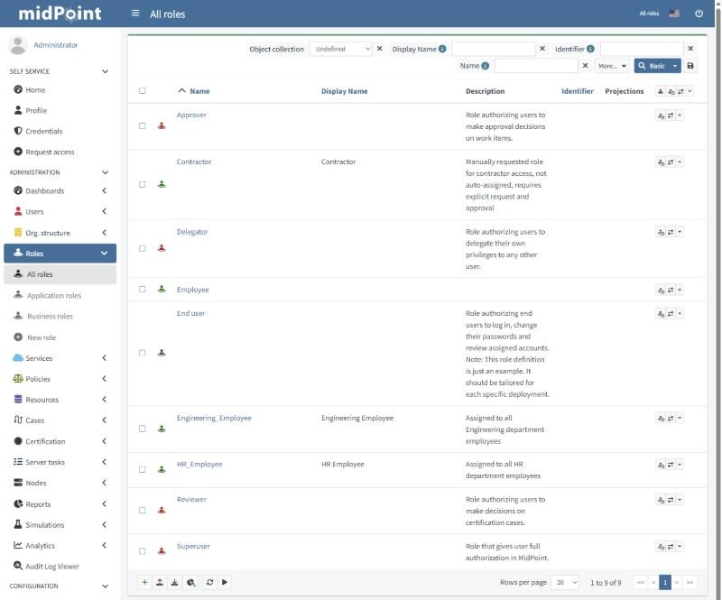
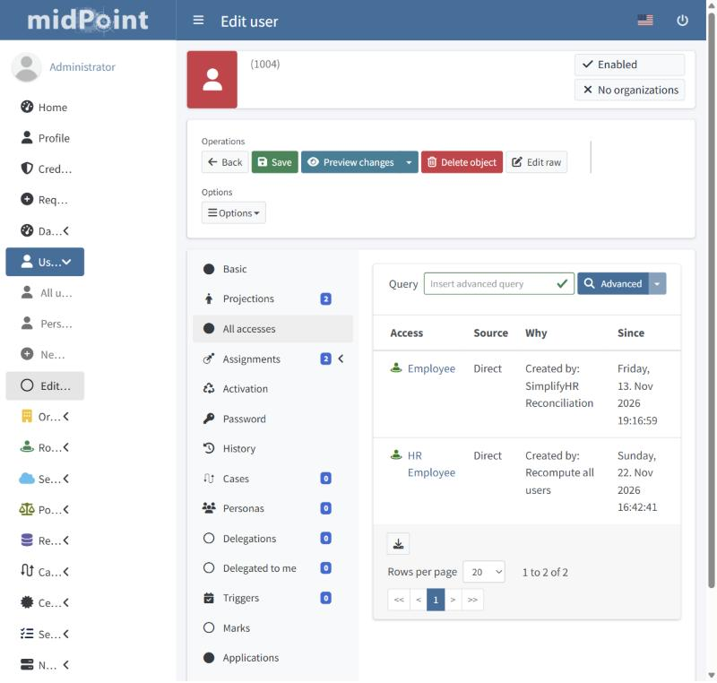
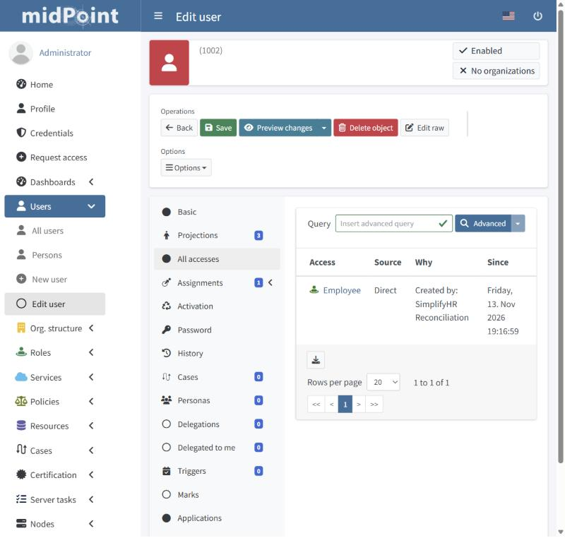
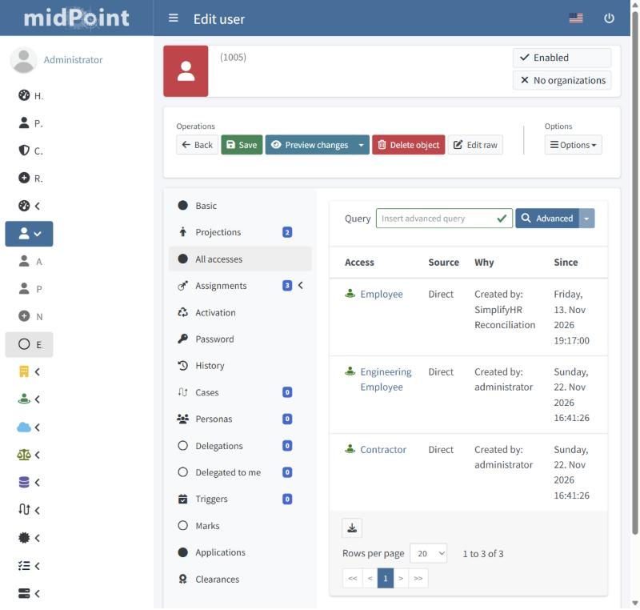
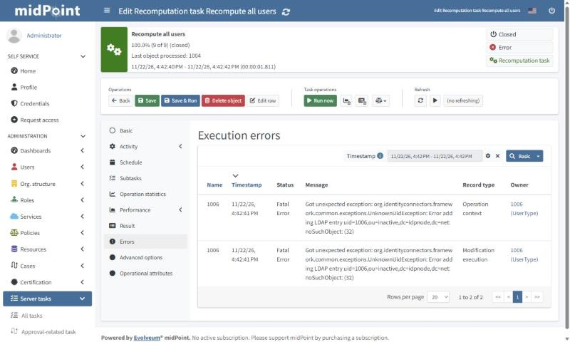
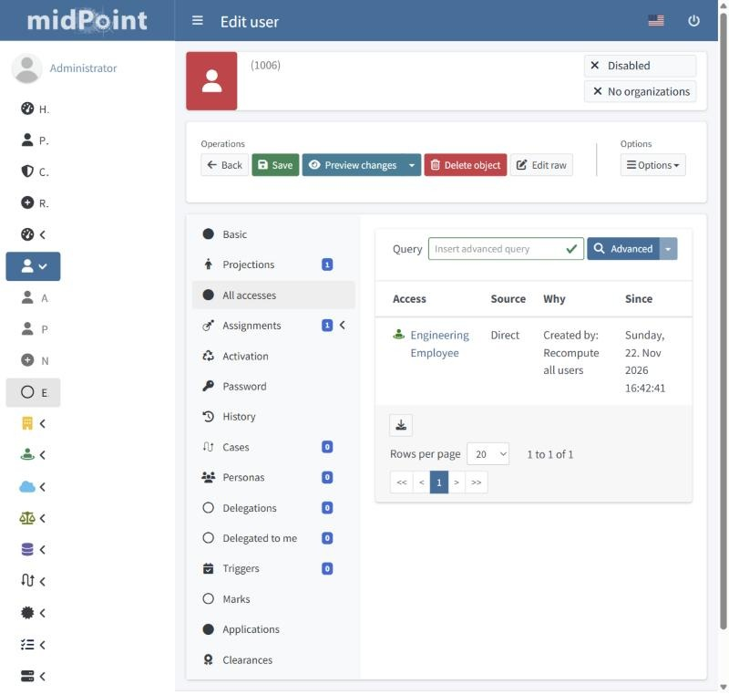

# RBAC: department roles from HR, plus a requested role

The `Employee` role from the [joiner-leaver](../joiner-leaver/) use case treats everyone the same: if you're enabled, you get a directory account. Real access isn't that flat. An engineer and someone in HR need different things, and some access shouldn't come from your job at all. You should have to ask for it.

In this use case I added three roles on top of `Employee` to cover both kinds:

- **Birthright roles** that come automatically from the department in HR
- **A requested role** that nobody gets unless they ask for it

```
HR department ──▶ organizationalUnit ──auto-assign──▶ Engineering_Employee / HR_Employee
HR status     ──▶ enabled / disabled  ──auto-assign──▶ Employee (LDAP account)
User request  ──▶ Request access      ──────────────▶ Contractor
```

## The roles

| Role | How you get it | What it gives | Who has it |
|---|---|---|---|
| `Employee` | Automatic, for every user who isn't disabled | An OpenLDAP account | All enabled users |
| `Engineering_Employee` | Automatic, when `organizationalUnit` is `Engineering` | An OpenLDAP account (same construction as `Employee`) | 1001, 1003, 1005, 1007 (and 1006, see below) |
| `HR_Employee` | Automatic, when `organizationalUnit` is `HR` | Nothing yet, no inducement | 1004 |
| `Contractor` | Requested by hand. Not auto-assigned | Nothing yet, no inducement | 1005 |



The roles list. `Approver`, `Delegator`, `End user`, `Reviewer` and `Superuser` come with midPoint. `Employee`, `Engineering_Employee`, `HR_Employee` and `Contractor` are mine.

## How it works

### Birthright roles from the department

HR already sends the department across. The inbound mapping puts it in the user's `organizationalUnit`. Each department role has an auto-assignment rule that looks at that field:

```xml
<autoassign>
    <enabled>true</enabled>
    <focus>
        <mapping>
            <name>autoassign-engineering</name>
            <strength>strong</strength>
            <source><path>organizationalUnit</path></source>
            <condition>
                <script><code>organizationalUnit == 'Engineering'</code></script>
            </condition>
        </mapping>
    </focus>
</autoassign>
```

`HR_Employee` is the same rule with `'HR'`. Because the mapping is strong, the role follows the department. If HR moves someone out of Engineering, the condition stops being true and the role should drop off on the next recompute. That's the mover case, and it's next on my list to test (see open points).

Nobody in midPoint assigns these roles by hand. Every assignment can be traced back to an HR value. Finance (1002 and 1008) has no department role yet, so those two only have `Employee`. That's on purpose too: it shows what a department without a role looks like.

I ran the `Recompute all users` task to apply the new rules to the people who were already there. midPoint evaluated all 9 users in under 2 seconds.


Sophie Müller (1001, Engineering). The **All accesses** view shows where each role came from: `Employee` was created by the SimplifyHR reconciliation on 13 November, and `Engineering Employee` was created by the recompute on 22 November.



Thomas Weber (1004) is in HR, so he got `HR Employee` from the same recompute.



James Anderson (1002) is in Finance. There's no Finance role, so he only has `Employee`.

### A role you have to ask for

`Contractor` works the other way round. It has no auto-assignment rule at all. The only way to get it is to request it.

I used **Request access** to request `Contractor` for Emma Clarke (1005) with the comment *"This access is required for contract work"*. midPoint stores that comment on the assignment along with who asked and when. So the reason for the access is recorded next to the access itself, not in a separate ticket somewhere.



Emma now has three roles from three different places: `Employee` from HR status, `Engineering Employee` from her department, and `Contractor` because it was requested.

## What I found when I recomputed everyone

The recompute finished with an **Error**, and the error turned out to be the most useful part of the lab.



Both errors are for user 1006: `Error adding LDAP entry uid=1006,ou=inactive,dc=idpnode,dc=net: noSuchObject (32)`.

User 1006 is Oliver Bennett, my leaver from the joiner-leaver test. He's disabled in midPoint, and his LDAP account was removed. Here's what happened:

1. Oliver's department in HR is still `Engineering`. That's normal: leaving doesn't erase your department.
2. The `Engineering_Employee` rule only checks the department, not whether the person is enabled. So the recompute gave Oliver the role.
3. `Engineering_Employee` has its own OpenLDAP account inducement, so midPoint tried to create a directory account for him again.
4. Because Oliver is disabled, my DN script sent the new account to `ou=inactive`. That's the branch I'd noted in joiner-leaver as one that "never fires". It fired here.
5. `ou=inactive` doesn't exist in my directory, so LDAP rejected the add.



Oliver is **Disabled**, but he has `Engineering Employee`, created by the recompute.

So the leaver control from HR (disabled means no `Employee` role, which means no account) got around through a second role. The only thing that stopped a leaver getting a directory account back was a missing OU. That's luck, not design. In a real environment, a department role like this could quietly re-provision access for people who have already left.

The lesson I took from it: **every role that grants access needs to respect the leaver state, not just the first one.** There are two ways to fix it:

- Add the status check to the department rules, so they only apply to enabled users (the same condition `Employee` uses).
- Or take the account inducement off the department roles entirely. Let `Employee` be the only role that creates the account, and have department roles add department-specific access on top of it. That way there's one place that decides "does this person get an account at all".

I'd go with the second one. It's cleaner, and it's how birthright roles usually get layered.

## Open points

- **Leavers picking up department roles.** This is the issue above. Oliver still has `Engineering_Employee` until I fix the condition or the inducement.
- **Contractor doesn't go through an approval yet.** The description says it needs approval, but there's no approval policy on the role. My request was granted straight away, and the Cases list is empty. The next step is adding an approver (the line manager or a role owner) so a request creates a case that someone has to approve.
- **`HR_Employee` and `Contractor` don't grant anything.** They're placeholders until I add inducements, for example an HR group in LDAP, or an expiry date on `Contractor` so contract access ends by itself.
- **Department names are matched as exact text.** `'Engineering'` works, but if HR sent `engineering` or `Engineering ` with a trailing space, nobody would get the role and nothing would flag it. Normalizing the value in the inbound mapping, or using an org structure instead of a text match, would be safer.
- **The roles got `Employee` assigned to them.** When I created the three new roles in the GUI, midPoint's `Employee` auto-assignment rule also fired on the roles themselves, because it isn't limited to users. It doesn't give anyone access, but it clutters the role definitions. The rule should apply to users only.
- **The mover test.** Change someone's department in HR and confirm the old department role drops off and the new one is added.
- **Separation of duties.** A rule like "`Contractor` and `HR_Employee` can't be held together" is a natural next step now that there are more roles.

## The config behind it

- [`rbac-roles.xml`](../config/rbac-roles.xml): `Engineering_Employee`, `HR_Employee` and `Contractor`, with the auto-assignment rules and the one inducement.
- [`employee-role.xml`](../config/employee-role.xml): the `Employee` birthright role from joiner-leaver, which the new roles sit on top of.
- [`ldap-dn.groovy`](../config/scripts/ldap-dn.groovy): the DN script whose `ou=inactive` branch showed up in the error.
